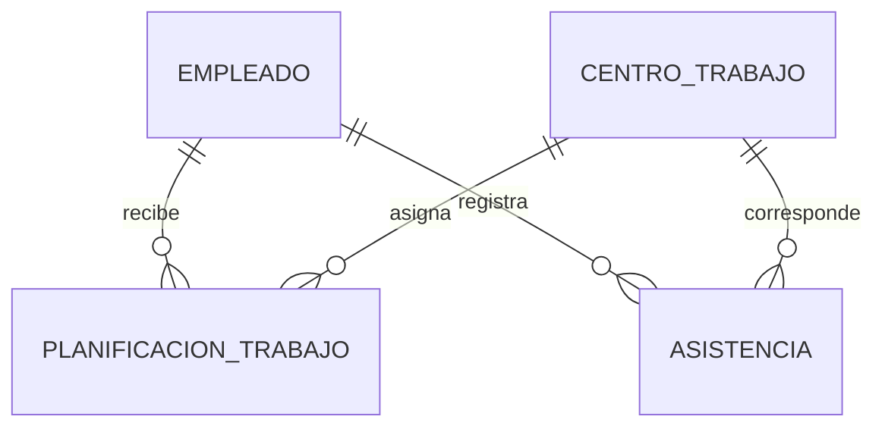

# Análisis técnico: módulo de asistencia

## 1. Objetivo

Diseñar una propuesta técnica para agregar un módulo de control de asistencia al sistema de empleados.

El módulo permitirá planificar mensualmente el centro de trabajo asignado a cada empleado y registrar diariamente su asistencia mediante la confirmación realizada con los encargados de cada centro.

## 2. Alcance

La propuesta incluye el diseño de tablas de base de datos, pantallas de operación, procesos principales, supuestos y preguntas para el encargado del proceso.

La implementación del módulo no forma parte del sistema actual; este documento describe cómo se desarrollaría en una etapa futura.

## 3. Suposiciones iniciales

- Un empleado puede trabajar en diferentes centros de trabajo según la planificación mensual.
- Un empleado solo puede tener una asignación de centro de trabajo por día.
- La asistencia se registra una vez por cada empleado y día.
- La asistencia será confirmada mediante llamadas telefónicas a los encargados de los centros de trabajo.
- Los estados iniciales de asistencia serán: Presente, Ausente y Justificado.

## 4. Modelo de datos propuesto

Para implementar el módulo se proponen tres nuevas entidades: Centro de trabajo, Planificación de trabajo y Asistencia.

### 4.1. Tabla CentroTrabajo

4.1. Tabla CentroTrabajo
Esta tabla almacenará los lugares donde los empleados pueden desempeñar sus labores.

| Campo | Tipo sugerido | Descripción |
|---|---|---|
| id | Entero | Identificador interno. |
| codigo | Texto | Código único del centro de trabajo. |
| nombre | Texto | Nombre del centro de trabajo. |
| direccion | Texto | Dirección física del centro. |
| encargado | Texto | Nombre de la persona responsable. |
| telefono_encargado | Texto | Teléfono para confirmar asistencias. |
| activo | Booleano | Indica si el centro está disponible para asignaciones. |

4.2. Tabla PlanificacionTrabajo
Esta tabla guardará la asignación planificada de un empleado a un centro de trabajo durante un período.

| Campo | Tipo sugerido | Descripción |
|---|---|---|
| id | Entero | Identificador interno. |
| empleado | Llave foránea | Empleado asignado. |
| centro_trabajo | Llave foránea | Centro asignado al empleado. |
| fecha_inicio | Fecha | Inicio de la asignación. |
| fecha_fin | Fecha | Fin de la asignación. |
| observacion | Texto | Nota opcional sobre la planificación. |

4.3. Tabla Asistencia
Esta tabla almacenará la asistencia diaria confirmada para cada empleado.

| Campo | Tipo sugerido | Descripción |
|---|---|---|
| id | Entero | Identificador interno. |
| empleado | Llave foránea | Empleado al que pertenece el registro. |
| centro_trabajo | Llave foránea | Centro donde se esperaba al empleado. |
| fecha | Fecha | Día de la asistencia. |
| estado | Texto | Presente, Ausente o Justificado. |
| observacion | Texto | Motivo, comentario o justificación. |
| confirmado_por | Texto | Persona que registró la confirmación. |
| fecha_confirmacion | Fecha y hora | Momento en que se registró la asistencia. |

Regla de negocio: debe existir un único registro de asistencia por empleado y fecha.

## 5. Pantallas de operación propuestas

### 5.1. Gestión de centros de trabajo

Permitirá listar, crear, editar y desactivar centros de trabajo.

Campos principales:

- Código.
- Nombre.
- Dirección.
- Nombre del encargado.
- Teléfono del encargado.
- Estado activo o inactivo.

### 5.2. Planificación mensual de trabajo

Permitirá asignar empleados a centros de trabajo para un período determinado.

La pantalla deberá permitir:

- Seleccionar un empleado.
- Seleccionar un centro de trabajo.
- Indicar fecha de inicio y fecha de fin.
- Agregar una observación opcional.
- Consultar, editar o eliminar asignaciones planificadas.

El sistema debe validar que un empleado no tenga dos asignaciones que se superpongan en la misma fecha.

### 5.3. Registro diario de asistencia

Permitirá registrar la asistencia confirmada mediante llamada telefónica.

La pantalla deberá mostrar los empleados planificados para una fecha y centro de trabajo seleccionado. Para cada empleado se podrá registrar:

- Estado de asistencia.
- Observación o motivo de ausencia.
- Persona que confirmó la información.
- Fecha y hora de la confirmación.

### 5.4. Consulta y reporte de asistencia

Permitirá buscar registros de asistencia mediante filtros como:

- Empleado.
- Centro de trabajo.
- Rango de fechas.
- Estado de asistencia.

El resultado mostrará los registros encontrados y permitirá generar un reporte para revisión administrativa.

## 6. Procesos principales

### 6.1. Planificación mensual

1. El usuario encargado registra los centros de trabajo disponibles.
2. Al inicio de cada mes, asigna cada empleado a un centro de trabajo para las fechas correspondientes.
3. El sistema valida que no existan asignaciones superpuestas para un mismo empleado.
4. La planificación queda disponible para consulta y para el registro diario de asistencia.

### 6.2. Confirmación diaria de asistencia

1. El usuario selecciona la fecha y el centro de trabajo.
2. El sistema muestra los empleados planificados para ese lugar y fecha.
3. El usuario realiza la llamada al encargado del centro.
4. Con la información recibida, registra el estado de cada empleado.
5. El sistema guarda la fecha, hora, observación y persona que realizó la confirmación.
6. El usuario puede consultar posteriormente los registros o generar reportes.

### 6.3. Corrección de registros

Si se registra información incorrecta, un usuario autorizado podrá editar la asistencia e ingresar una observación que explique el cambio realizado.

## 7. Consultas para el encargado del proceso

Antes de implementar el módulo, realizaría las siguientes preguntas:

1. ¿Un empleado puede estar asignado a más de un centro de trabajo en el mismo día?
2. ¿Existen turnos u horarios distintos para cada empleado o centro de trabajo?
3. ¿Qué estados de asistencia deben manejarse además de Presente, Ausente y Justificado?
4. ¿Quiénes estarán autorizados para crear planificaciones y registrar asistencia?
5. ¿Las asistencias pueden modificarse después de registrarse? En caso afirmativo, ¿debe guardarse un historial de cambios?
6. ¿Qué información debe contener la justificación de una ausencia?
7. ¿Cómo se procederá cuando el encargado del centro no responda la llamada?
8. ¿Se requiere registrar retardos, horas extras, permisos o trabajo remoto?
9. ¿Qué reportes necesita la empresa y con qué frecuencia deben generarse?
10. ¿La planificación debe repetirse automáticamente cada mes o siempre se registrará manualmente?

## 8. Reportes propuestos

El módulo debería permitir generar al menos los siguientes reportes:

- Asistencia por empleado dentro de un rango de fechas.
- Asistencia por centro de trabajo.
- Listado de ausencias y justificaciones.
- Resumen mensual de presentes, ausentes y justificados por empleado.
- Empleados planificados por centro de trabajo y período.

## 9. Conclusión

La propuesta permite extender el sistema actual de empleados mediante un módulo de asistencia organizado y escalable.

La separación entre centros de trabajo, planificación y asistencia permite conservar la información histórica, evitar asignaciones duplicadas y consultar el cumplimiento diario de los empleados.

Antes de iniciar el desarrollo, será necesario validar las reglas de negocio y las respuestas del encargado del proceso para ajustar el diseño final.